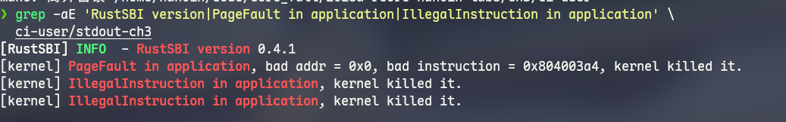

# lab1 多道程序与分时多任务

## 功能总结 

实现了任务系统调用的追踪。即让内核在发布前可为当前任务记录调用次数，任务通过`sys_trace`来读取或写入`id`地址处内容，以及查询某个系统调用的调用次数，查询追踪调用自身时包含本次调用

## 简答题  


### 三个 bad 测例的现象



- `ch2b_bad_address` 访问地址 0，日志显示 `PageFault` 
- `ch2b_bad_instructions` 因 用户态执行特权指令`sret`触发`IllegalInstruction`
- `ch2b_bad_register` 因访问特权 CSR S态寄存器，触发 `IllegalInstruction`。内核终止相应应用，其他应用继续执行。  
RustSBI 0.4.1。

### trap.S 中保存与恢复函数

1. **进入 `__restore` 时的 `sp`**：指向内核栈上保存的 `TrapContext`。两种场景一是任务首次进入用户态（上下文由内核预构造）二是一次 Trap 处理完成后恢复用户态。
2. **特殊处理的寄存器**：  
```asm
ld t0, 32*8(sp)
ld t1, 33*8(sp)
ld t2, 2*8(sp)
csrw sstatus, t0
csrw sepc, t1
csrw sscratch, t2
```
特殊处理了三个寄存器
`sstatus` 留存回归U态的权限（如 `SPP`）；`sepc` 指定返回的指令地址；用户 `x2` 先写进 `sscratch`，供最后交换恢复栈。

3. **跳过 `x2` 和 `x4`**：  
```asm 
ld x1, 1*8(sp)
ld x3, 3*8(sp)
.set n, 5
.rept 27
   LOAD_GP %n
   .set n, n+1
.endr
```
`x2` 是栈指针，汇编此时还要用它读取内核栈，不能提前写回；`x4` 是 `tp`在这里是线程指针，我们不希望用户tp在内核路径上被修改

4. **恢复末尾执行 `csrrw` 后**：`sp` 变为用户栈指针，`sscratch` 保存内核栈顶，供下一次从用户态进入时使用。
5. **S 态回到 U 态**：由 `sret` 完成；保存好的 `sstatus.SPP` 指定返回 U 态，PC 从 `sepc` 恢复。
6. **进入 `__alltraps` 的第一次 `csrrw` 后**：`sp` 指向内核栈顶，`sscratch` 暂存陷入时的用户栈指针。
7. **U 态到 S 态**：系统调用时由用户的 `ecall` 触发异常，硬件按委托配置进入 S 态并转到 `stvec`；不是处理程序里的栈交换指令完成提权。用户异常和中断也可能触发进入。

## 荣誉准则

在完成本次实验的过程（含此前学习的过程）中，我曾分别与 以下各位 就（与本次实验相关的）以下方面做过交流，还在代码中对应的位置以注释形式记录了具体的交流对象及内容：

未与他人交流，仅与chatgpt与deepseek进行交流学习过

此外，我也参考了 以下资料 ，还在代码中对应的位置以注释形式记录了具体的参考来源及内容：

[指导书第二章：实现特权级的切换](https://learningos.cn/rCore-Tutorial-Guide/chapter2/4trap-handling.html)和[riscv手册](http://riscvbook.com/chinese/RISC-V-Reader-Chinese-v2p1.pdf)，理解ecall、sret，以及 sstatus、sepc、sscratch 在 Trap 前后的作用。
[指导书第三章：任务切换](https://learningos.cn/rCore-Tutorial-Guide/chapter3/2task-switching.html) 区分 `__switch` 的任务上下文与 `__alltraps` / `__restore` 的 Trap 上下文。

3. 我独立完成了本次实验除以上方面之外的所有工作，包括代码与文档。 我清楚地知道，从以上方面获得的信息在一定程度上降低了实验难度，可能会影响起评分。

4. 我从未使用过他人的代码，不管是原封不动地复制，还是经过了某些等价转换。 我未曾也不会向他人（含此后各届同学）复制或公开我的实验代码，我有义务妥善保管好它们。 我提交至本实验的评测系统的代码，均无意于破坏或妨碍任何计算机系统的正常运转。 我清楚地知道，以上情况均为本课程纪律所禁止，若违反，对应的实验成绩将按“-100”分计。
